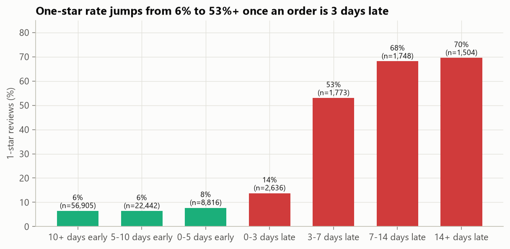
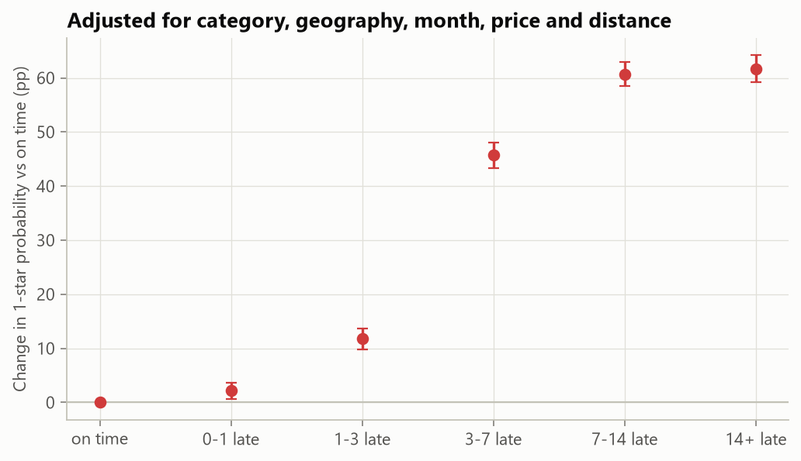
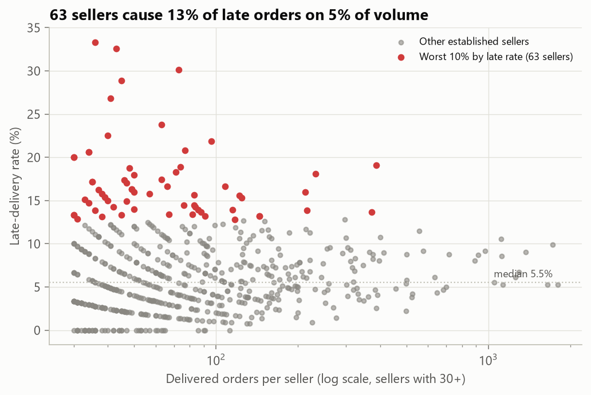
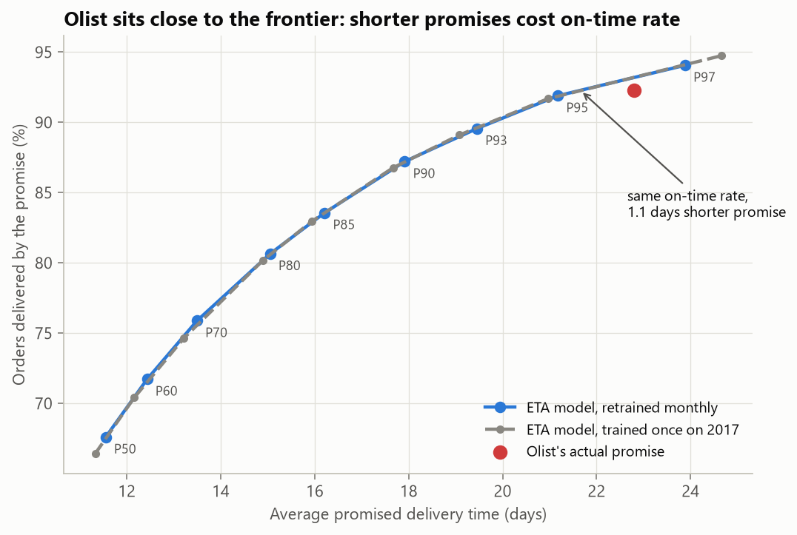

# Late deliveries, bad reviews and padded promises: an analytics-engineering study of 99k marketplace orders

  

Olist is a Brazilian marketplace that connects small sellers to large e-commerce channels. Its public dataset holds 99,441 orders (2016–2018) across nine raw tables. This project does two jobs a data team at a marketplace actually does:

1. **Analytics engineering:** turn messy raw exports into a tested, documented warehouse (dbt + DuckDB): staging → intermediate → marts, with 43 data tests that run on every build.
2. **Decision analysis on top of it:** quantify what a late delivery costs, find where lateness comes from, and test whether a delivery-time model could promise customers earlier dates.

**The short version:**
- A late order is **46 percentage points** more likely to get a 1-star review, after controlling for category, geography, month, price and distance.
- **63 sellers** (the worst 10% of established sellers) handle 5% of orders but cause **13% of late deliveries**. Bringing them to the median late rate would avoid about 8.5% of all late orders.
- Olist's promised dates are padded: orders arrive a median **12 days early**. A quantile ETA model can match Olist's on-time rate with promises about **1.1 days shorter**, and shows the price of going further: about 5 days shorter costs 5 points of on-time rate.



## Results at a glance

| Question | Answer | Evidence |
|---|---|---|
| How big is the business? | R$15.7M GMV, 99,441 orders, 94,990 customers | `marts.fct_orders`, `marts.dim_customers` |
| Do customers come back? | Rarely | 3.0% of customers ever place a second order; under 1% of any cohort orders in a given later month |
| How often are orders late? | 6.8% of delivered orders | One-day grace on the promised date |
| What does lateness cost in reviews? | −1.96 stars on average; +46 pp chance of a 1-star review | OLS with category, state, month and order controls; seller-clustered 95% CI [44.7, 47.4] pp |
| Is the damage gradual? | No, it is a cliff | 1-star probability: +2 pp at 0–1 days late, +12 pp at 1–3, **+46 pp at 3–7**, +61 pp beyond a week |
| Does lateness reduce repeat purchases? | Not detectably | −0.4 pp within 180 days, CI [−1.0, +0.1]; the 3% base rate leaves little room to detect it |
| Where does lateness come from? | A small set of sellers | Worst-decile sellers: 16.6% late rate vs 5.5% median; 13% of late orders on 5% of volume; bad-review rate 22% vs 11% |
| Can a model promise earlier dates? | A little at the same on-time rate | 21.7 vs 22.8 promised days at 92.3% on time (2018 hold-out, retrained monthly) |

## The warehouse

```
data/raw/*.csv ──(read in place by DuckDB)──> staging (8 views) ──> intermediate (3 views) ──> marts (7 tables)

staging        one model per source table: types, renames, zip-code normalisation, review de-duplication,
               zip centroids from 1M geolocation rows (points outside Brazil dropped)
intermediate   order-level rollups: items (primary seller/category, weight, volume), payments, delivery timing
marts/core     fct_orders (one row per order, 31 columns), dim_customers (per real person), dim_sellers
marts/analytics mart_monthly_kpis, mart_cohort_retention, mart_seller_scorecard, mart_delivery_vs_review
```

### Data-quality problems found and handled in the models

| Problem in the raw data | Where it is handled | Test that guards it |
|---|---|---|
| Zip prefixes arrive as integers in some files and strings in others (leading zeros lost) | `zip_prefix` macro in every staging model | relationships between orders, customers and sellers |
| One person has a new `customer_id` on every order, so "customers" are overcounted | `dim_customers` keys on `customer_unique_id` | `unique`, `not_null` |
| Duplicate reviews and several reviews per order | `stg_olist__reviews` keeps the latest answered review | `unique` on `order_id` |
| Geolocation points in the ocean or outside Brazil | bounding-box filter, then median per zip | distance between 0 and 5,000 km |
| Payments that don't equal items + freight (vouchers, rounding) | flagged, not dropped | `row_share_below`: fewer than 2% of orders may differ by more than R$1 |
| "Delivered" orders with no delivery timestamp | kept, excluded from timing metrics | `row_share_below`: fewer than 0.1% |

Two custom generic tests (`expression_is_true`, `row_share_below`) live in [`dbt/tests/generic`](dbt/tests/generic). The second expresses a tolerance ("fewer than 2% of rows may…"), which is how real data contracts are usually written.

## Analysis

### 1. What a late delivery costs



Late orders are not random: they skew toward remote states, heavy items and certain sellers. The effect is therefore estimated with fixed effects for product category, customer state, seller state and purchase month, plus price, freight, item count and seller-to-customer distance, with standard errors clustered by seller. Adjustment barely moves the estimate (raw +47.1 pp, adjusted +46.1 pp), which suggests the review penalty is about lateness itself rather than the kinds of orders that run late. This is still an observational estimate, not an experiment.

The dose-response is the practical finding. A delivery one day late costs little; three or more days late is where reviews collapse. Operations should treat "more than 3 days late" as the incident threshold.

### 2. Where lateness comes from



Among the 622 sellers with 30+ delivered orders (83% of volume), the worst decile runs a 16.6% late rate against a 5.5% median. Lifting those 63 sellers to the median would remove about 550 late orders, roughly 8.5% of all late deliveries, with no change to carriers or promises. Seller-level coaching or penalties are the cheapest lever in this analysis.

### 3. Can we promise earlier delivery dates?



A LightGBM quantile model predicts each order's delivery time from information available at checkout: distance, states, freight, weight and volume, category, the seller's past handling time, and two "nowcast" features (how fast deliveries have been arriving network-wide and to the customer's state in the last 2–4 weeks). It is evaluated on all of 2018, retrained monthly.

| Promise rule (2018, 52,777 orders) | Avg promised days | Delivered by promise |
|---|---|---|
| Olist's actual estimate | 22.8 | 92.3% |
| Model P95 | 21.2 | 91.9% |
| Model P90 | 17.9 | 87.2% |
| Model P80 | 15.1 | 80.7% |
| Model P50 | 11.6 | 67.6% |

At Olist's own on-time rate, the model promises about **1.1 days earlier**. Olist's estimate turns out to sit close to the efficient frontier, so the padding is mostly the price of the long delivery tail. The model's real value is that it makes the trade-off explicit. A P90 promise would be 4.9 days shorter at the cost of 5.1 more late orders per 100. At the measured +46 pp 1-star penalty, that is about 24 extra 1-star reviews per 1,000 orders. Whether that is worth it depends on how much a shorter promise lifts conversion, which this dataset cannot observe. The next step is an A/B test of promise rules, not a model change.

Median-delivery accuracy: the P50 model's MAE is 4.98 days vs 5.32 days for a seller-state × customer-state median (6% better).

### Things that went wrong, and the fixes

- **Drift (partly unresolved).** Deliveries slowed in 2018 (peak season and the May 2018 truckers' strike), so the quantiles under-cover: the P90 forecast covers only 84% of 2018 orders. Monthly retraining and nowcast features did not close that gap (static 2017 model: 83%). The trade-off table is unaffected because each rule is scored by its *realised* on-time rate, but a deployed version should add conformal recalibration on the most recent mature month so that "P90" means 90%.
- **Censoring bias in retraining.** Retraining at the start of a month on "orders already delivered" keeps the fast recent orders and silently drops the slow ones still in transit, so the model learns that delivery is quicker than it is. Training now stops 45 days before each retrain date, when about 99% of orders have arrived.
- **Leakage in seller history.** The seller's past delivery time counts only orders that had *arrived* before the new order was placed (unit-tested in [`tests/test_eta.py`](tests/test_eta.py)).

## Recommendations

1. **Act on the 63 worst sellers first.** It is the largest controllable lever (about 8.5% of late orders) and needs no new technology. Many of them have only 30–60 orders, so part of their excess is noise: rank sellers on an empirical-Bayes (shrunk) late rate before any penalty, and expect the realised gain to be somewhat smaller than 8.5%.
2. **Treat 3+ days late as an incident.** Reviews hold up to about one day late and collapse after three, so proactive messaging and vouchers should target that window.
3. **Do not shorten promises without an experiment.** The ETA model can generate promise rules; an A/B test should measure the conversion gain against the review cost quantified here.
4. **Retention is structurally low (3%).** Lateness is not the explanation, since its effect on repeat purchase is not distinguishable from zero. Growth here comes from acquisition and seller quality.

## Reproduce

```bash
python -m venv .venv && source .venv/bin/activate     # Windows: .venv\Scripts\activate
pip install -r requirements.txt
python scripts/download_data.py      # 9 CSVs, ~126 MB, from Olist's public repository
python scripts/run_all.py            # dbt build (18 models + 43 tests, ~15 s) then the analyses (~10 min)
pytest -q
```

To explore the warehouse: `duckdb data/warehouse/olist.duckdb`, then for example `select * from marts.mart_seller_scorecard order by late_rate desc limit 10;`. Run `dbt docs generate && dbt docs serve` inside `dbt/` for the lineage graph.

## Repository structure

```
dbt/
  models/staging/       8 source-aligned views + source and test definitions
  models/intermediate/  order-level rollups
  models/marts/         fct_orders, dim_customers, dim_sellers + 4 analytics marts
  macros/               zip normalisation, haversine distance, schema naming
  tests/generic/        expression_is_true, row_share_below
src/olist_analysis/
  effects.py            late-delivery effects on reviews and repeat purchase (OLS, fixed effects, clustered SEs)
  eta.py                leak-free features, nowcasts, quantile models, monthly retraining, promise trade-off
scripts/                download_data.py, run_all.py
tests/                  seller-history and nowcast leakage tests, trade-off math
reports/                figures/, tables/, RESULTS.md, metrics.json
```

## Data

[Olist Brazilian E-Commerce Public Dataset](https://github.com/olist/work-at-olist-data) (also on Kaggle as `olistbr/brazilian-ecommerce`), CC BY-NC-SA 4.0. Orders from September 2016 to October 2018; customer and seller identities are anonymised.
